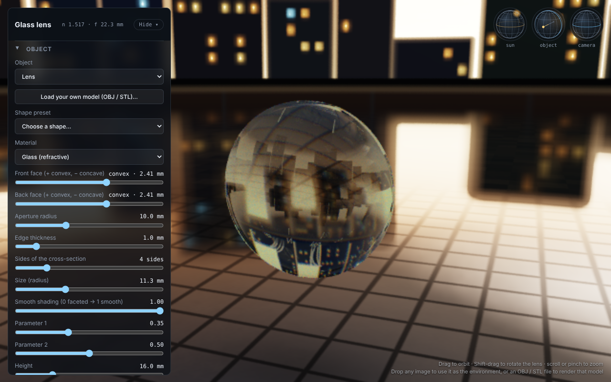

# Glass Real Optics Bench

A single-file WebGL2 path tracer that models glass lenses and other objects on a tiled floor, lit by a simulated sun and an environment map.

**[Live demo](https://mpragliola.github.io/glass-real-optics-bench/)**

*Software-rendered screenshot with caustics off; on a real GPU the page also renders the sun's caustics on the floor.*

## Features

- Lens with independent convex, flat or concave faces; also spheres, tapered solids, Platonic solids, SDF shapes and loaded triangle meshes (OBJ/STL, drag and drop)
- Refraction with Fresnel, total internal reflection, absorption, dispersion and surface roughness
- Second "Surface" material: matte to glossy, non-metal to metal, clear coat, subsurface scattering
- Sun with photon-mapped caustics on the floor; floor reflects the object
- Environment map from any image
- Orbs to drag-control the sun, the object and the camera
- Progressive accumulation with a low-resolution preview while interacting

## Run locally

Open `index.html` in a browser that supports WebGL2. No build step.

## Deployment

Pushes to `main` publish `index.html` to the `gh-pages` branch via `.github/workflows/deploy-pages.yml`. The action uses `keep_files: true`, so other files already on that branch are not removed.
